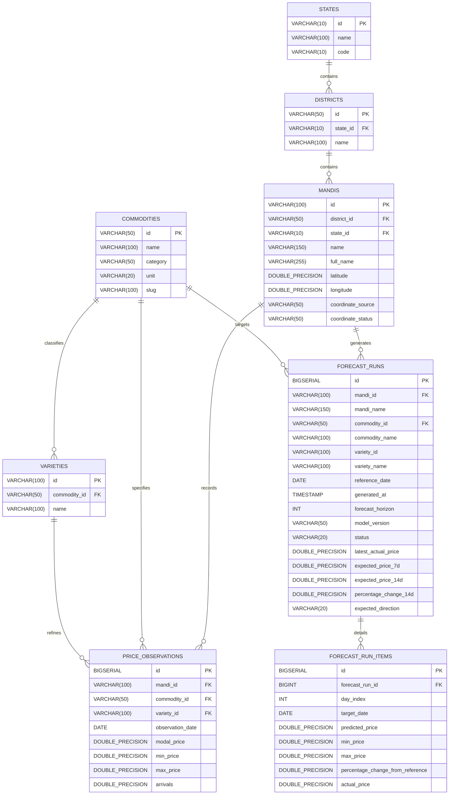

# Database Schema & Entity Relationships — Agri

## 1. Database Specifications

- **Database Engine:** PostgreSQL 14 (compatible with 15 & 16)
- **Database Name:** `agriforecasting`
- **Default Port:** `5432`
- **Connection URL:** `jdbc:postgresql://localhost:5432/agriforecasting`
- **Dialect:** `org.hibernate.dialect.PostgreSQLDialect`
- **Connection Pool:** HikariCP (`maximum-pool-size: 20`, `minimum-idle: 5`)

---

## 2. Entity-Relationship Diagram



---

## 3. Physical DDL & Index Strategy

The schema is created via `scripts/create_schema.sql`:

```sql
-- Composite performance indexes for sub-millisecond retrieval

-- 1. Historical Prices (1.136M records)
CREATE INDEX idx_price_lookup 
    ON price_observations(mandi_id, commodity_id, observation_date DESC);

CREATE UNIQUE INDEX idx_price_unique_obs 
    ON price_observations(mandi_id, commodity_id, variety_id, observation_date);

-- 2. Mandi Geography & Search
CREATE INDEX idx_mandis_state_district 
    ON mandis(state_id, district_id);

CREATE INDEX idx_mandis_coords 
    ON mandis(latitude, longitude) WHERE latitude IS NOT NULL;

CREATE INDEX idx_mandis_name_trgm 
    ON mandis USING btree (LOWER(name));

-- 3. Forecast Runs & Items
CREATE INDEX idx_forecast_runs_lookup 
    ON forecast_runs(mandi_id, commodity_id, variety_id, reference_date);

CREATE INDEX idx_forecast_runs_gen 
    ON forecast_runs(generated_at DESC);

CREATE INDEX idx_forecast_run_items_parent 
    ON forecast_run_items(forecast_run_id, day_index);
```

---

## 4. Current Database Row Counts & Audit

Verified directly against PostgreSQL `localhost:5432/agriforecasting`:

| Table | Live Row Count | Ingestion Method | Notes |
|---|---|---|---|
| `states` | **30** | `ingest_national_geography.py` | 100% of Indian states and UTs in dataset |
| `districts` | **913** | `ingest_national_geography.py` | Hierarchical mapping from source records |
| `mandis` | **2,643** | `ingest_national_geography.py` | 2,548 verified geocoded (96.4%); 95 NULL coords |
| `commodities` | **15** | `ingest_national_geography.py` | Major cereal, pulse, vegetable, and oilseed crops |
| `varieties` | **262** | `ingest_national_geography.py` | Full botanical variety mapping |
| `price_observations` | **1,136,107** | `ingest_historical_prices.py` | 100% covered across all 2,643 mandis |
| `forecast_runs` | Dynamic | Application Runtime | Persistent forecast audit history |
| `forecast_run_items`| Dynamic | Application Runtime | Exactly 14 daily rows per forecast run |
