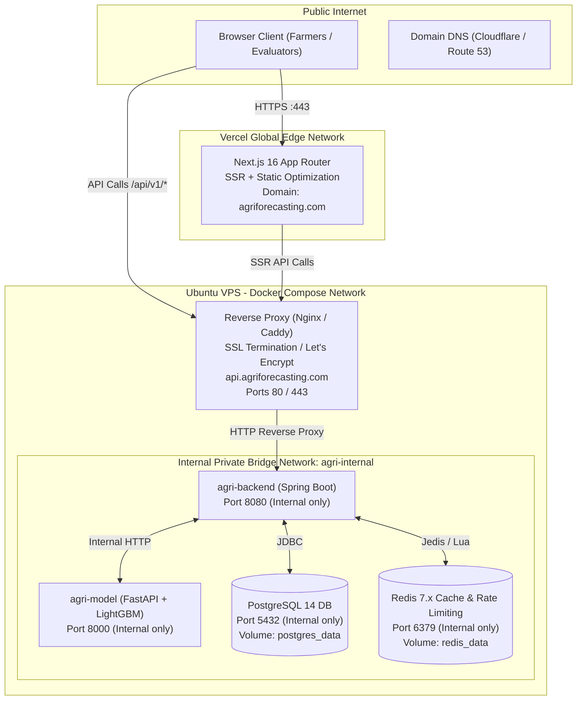

# Deployment Architecture & Infrastructure Runbook — Agri

## 1. Owner Decision: Option A (Vercel + Single VPS) `[DECIDED]`

The Product Owner explicitly selected **Option A**:
- **Frontend:** Next.js deployed globally on **Vercel** Edge.
- **Backend & Database:** Containerized on a single **Ubuntu VPS** (approx. 2 vCPU, 4 GB RAM, 40–60 GB NVMe SSD) via **Docker Compose**.
- **Reverse Proxy:** Nginx or Caddy managing SSL termination (Let's Encrypt) and routing.
- **No Kubernetes:** Explicitly rejected for this stage.

---

## 2. Infrastructure Diagram



---

## 3. Production Docker Compose Configuration

File: `docker-compose.yml`

```yaml
version: '3.8'

services:
  postgres:
    image: postgres:14-alpine
    container_name: agri-postgres
    restart: always
    environment:
      POSTGRES_DB: ${POSTGRES_DB:-agriforecasting}
      POSTGRES_USER: ${POSTGRES_USER:-postgres}
      POSTGRES_PASSWORD: ${POSTGRES_PASSWORD:-postgres}
    volumes:
      - postgres_data:/var/lib/postgresql/data
    networks:
      - agri-internal
    healthcheck:
      test: ["CMD-SHELL", "pg_isready -U postgres"]
      interval: 10s
      timeout: 5s
      retries: 5

  redis:
    image: redis:7-alpine
    container_name: agri-redis
    restart: always
    command: redis-server --appendonly yes --requirepass ${REDIS_PASSWORD:-redispassword}
    volumes:
      - redis_data:/data
    networks:
      - agri-internal

  model-service:
    build:
      context: ./model-service
      dockerfile: Dockerfile
    container_name: agri-model-service
    restart: always
    environment:
      MODEL_PATH: /app/model/price_lgbm_full_features.pkl
    networks:
      - agri-internal
    depends_on:
      - postgres

  backend:
    build:
      context: ./backend
      dockerfile: Dockerfile
    container_name: agri-backend
    restart: always
    environment:
      SPRING_PROFILES_ACTIVE: prod
      SPRING_DATASOURCE_URL: jdbc:postgresql://postgres:5432/agriforecasting
      SPRING_DATASOURCE_USERNAME: ${POSTGRES_USER:-postgres}
      SPRING_DATASOURCE_PASSWORD: ${POSTGRES_PASSWORD:-postgres}
      MODEL_SERVICE_URL: http://model-service:8000
      SPRING_DATA_REDIS_HOST: redis
      SPRING_DATA_REDIS_PORT: 6379
      SPRING_DATA_REDIS_PASSWORD: ${REDIS_PASSWORD:-redispassword}
    networks:
      - agri-internal
    depends_on:
      postgres:
        condition: service_healthy
      model-service:
        condition: service_started

  nginx:
    image: nginx:alpine
    container_name: agri-nginx
    restart: always
    ports:
      - "80:80"
      - "443:443"
    volumes:
      - ./nginx/nginx.conf:/etc/nginx/nginx.conf:ro
      - ./nginx/ssl:/etc/nginx/ssl:ro
    networks:
      - agri-internal
    depends_on:
      - backend

volumes:
  postgres_data:
  redis_data:

networks:
  agri-internal:
    driver: bridge
```

---

## 4. Reverse Proxy & Security Rules

1. **SSL Termination:** Managed via Let's Encrypt Certbot.
2. **CORS Headers:** Configured to strictly permit `https://agriforecasting.com` and Vercel preview URLs.
3. **Internal Port Cloaking:** Ports `5432`, `6379`, `8000`, and `8080` are **never mapped to host ports in production**. Only port `80` and `443` on Nginx are public.
