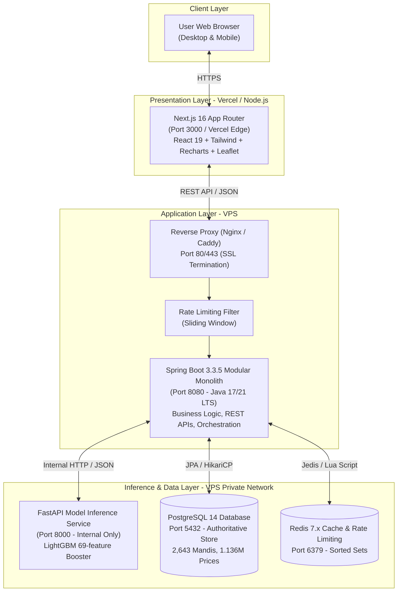

# System Architecture — Agri

## 1. Architectural Overview

Agri is built as a **clean three-layer architecture** with strict separation of concerns, clear interface boundaries, and no bypass paths.

---

## 2. Layer Boundaries & Isolation Guarantees

1. **Frontend Isolation:**
   - The Next.js frontend communicates **only** with the Java backend via HTTP REST endpoints (`/api/v1/*`).
   - The frontend **never** connects directly to PostgreSQL, Redis, or the Python inference service.
2. **Backend Authority:**
   - Spring Boot is the authoritative backend and business logic orchestrator.
   - It manages geographic discovery, rate limiting, price query aggregations, prediction history persistence, and multi-mandi comparisons.
3. **Inference Encapsulation:**
   - The Python FastAPI service (`:8000`) is completely unexposed to the public internet.
   - It only accepts internal HTTP requests from the Java backend containing authenticated feature payloads and returns structured 14-day prediction arrays.
4. **Data Store Security:**
   - PostgreSQL (`:5432`) and Redis (`:6379`) bind only to `127.0.0.1` or the internal Docker network. Neither is publicly accessible.

---

## 3. Technology Stack Reference

| Tier | Component | Technology / Version | Justification |
|---|---|---|---|
| **Frontend** | Framework | Next.js 16.4.6 (Turbopack, App Router) | Server-Side Rendering (SSR), Partial Prerendering (PPR), fast page loads |
| | Language | TypeScript 5.x | Strict type safety, shared domain interfaces |
| | Styling | Tailwind CSS 4.x + shadcn/ui | Clean, minimal, mobile-first design system |
| | Visualization | Recharts 3.11 | High-performance SVG charting with dual actual/forecast series |
| | Maps | Leaflet 1.9.4 + OpenStreetMap tiles | Lightweight interactive mapping without expensive proprietary API keys |
| **Backend** | Framework | Spring Boot 3.3.5 | Robust LTS modular monolith, enterprise-grade data access, production reliability |
| | Language | Java 17 / 21 LTS | Strong typing, high concurrency, long-term stability |
| | Data Access | Spring Data JPA + Hibernate 6.5 | Normalized entities, automated schema validation, connection pooling (HikariCP) |
| | Rate Limiting | Custom Sliding-Window (Lua + Redis) | Atomic rolling quota enforcement per client IP |
| **Model** | Framework | FastAPI + Uvicorn (Python 3.10-3.15) | Async, lightweight internal micro-service for model inference |
| | ML Engine | LightGBM 4.x + Scikit-Learn | Validated gradient-boosted decision tree artifact (`price_lgbm_full_features.pkl`) |
| **Data** | Primary DB | PostgreSQL 14 / 16 | Relational ground truth, foreign keys, composite B-tree indexes |
| | In-Memory | Redis 7.x | Fast sliding-window timestamp tracking for distributed rate limiting |
