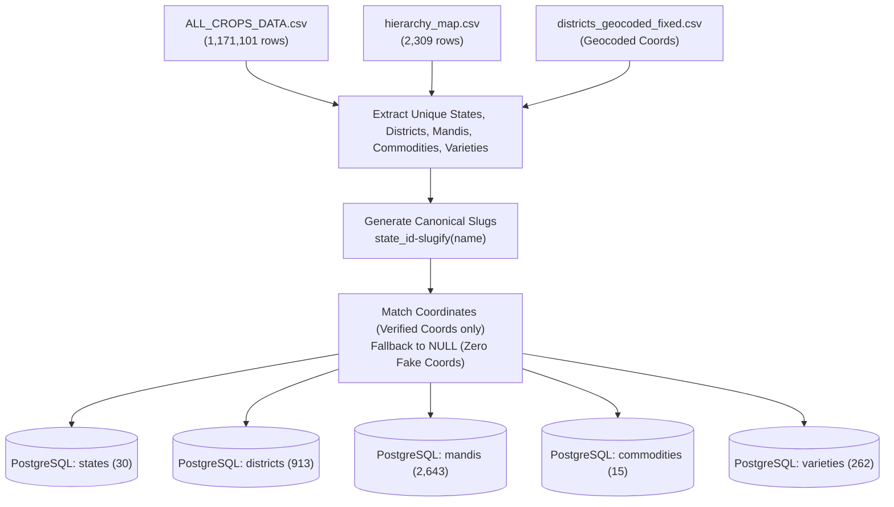

# National Mandi Geography Ingestion Pipeline — Agri

## 1. Pipeline Overview

The geography ingestion script is located at `scripts/ingest_national_geography.py`.

It extracts, normalizes, deduplicates, and ingests all states, districts, mandis, commodities, and varieties into PostgreSQL.

---

## 2. Ingestion Logic & Reconciliation



---

## 3. Resolving Homonym Collisions

In the source dataset, 28 APMC mandi names exist in multiple states (e.g. `Adampur APMC` in both Punjab and Haryana; `Banda APMC` in UP and MP).

If raw slugs like `adampur-apmc` were used as primary keys, one of the two markets would be dropped.

**Resolution:**
Every mandi is assigned a state-prefixed canonical slug:
- Punjab: `pb-adampur-apmc`
- Haryana: `hr-adampur-apmc`

This ensures **100% preservation of all 2,643 physical mandi entities** with zero database key collisions.

---

## 4. Execution Command & Performance

```bash
/tmp/agri_test_venv/bin/python3 /Users/karthikreddy/Desktop/Agri/scripts/ingest_national_geography.py
```

- **Execution Duration:** ~2.8 seconds
- **Output Audit Artifact:** `scripts/geography_reconciliation.json`
```json
{
  "states_count": 30,
  "districts_count": 913,
  "mandis_count": 2643,
  "mandis_with_coords": 151,
  "mandis_null_coords": 2492,
  "commodities_count": 15,
  "varieties_count": 262,
  "verified_coords_count": 151,
  "unresolved_count": 2492
}
```
