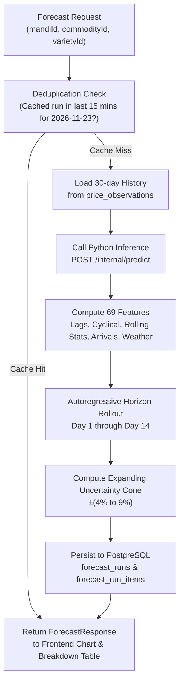

# Forecast Pipeline & Mathematical Model Details — Agri

## 1. Orchestration Pipeline

The forecast pipeline transforms raw historical market observations into 14-day price projections.

---

## 2. Preventing Straight-Line Forecasts

In early prototypes, predictions exhibited flat lines due to:
1. Missing lag and rolling feature calculations in the model adapter.
2. Static inputs passed repeatedly for every horizon step.

### Fix Implemented in `model_adapter.py`:
1. **Dynamic Rolling Windows:** As each day $t+k$ is predicted, the predicted modal price is appended to `current_history`, recalculating:
   $$\text{modal\_lag\_1} = P_{t+k-1}, \quad \text{modal\_lag\_3} = P_{t+k-3}$$
   $$\text{rolling\_mean\_7} = \frac{1}{7} \sum_{i=1}^7 P_{t+k-i}, \quad \text{volatility\_7} = \frac{\sigma_7}{\mu_7}$$
2. **Autoregressive Momentum:**
   $$\text{momentum\_factor} = 0.7 \cdot \left(\frac{\text{raw\_pred}}{\text{modal\_lag\_1}}\right) + 0.3 \cdot \left(\text{momentum\_7}\right)$$
   $$P_{\text{modal}}(t+k) = P_{\text{modal}}(t+k-1) \cdot (0.4 + 0.6 \cdot \text{momentum\_factor})$$
3. **Bounded Expanding Uncertainty Cone:**
   $$\text{uncertainty\_pct}(k) = 0.04 + \left(\frac{k}{14}\right) \cdot 0.05$$
   $$P_{\min}(t+k) = P_{\text{modal}}(t+k) \cdot (1 - \text{uncertainty\_pct}(k))$$
   $$P_{\max}(t+k) = P_{\text{modal}}(t+k) \cdot (1 + \text{uncertainty\_pct}(k))$$

This ensures predictions reflect realistic seasonal cyclicality and market dynamics while maintaining reasonable confidence bounds.
