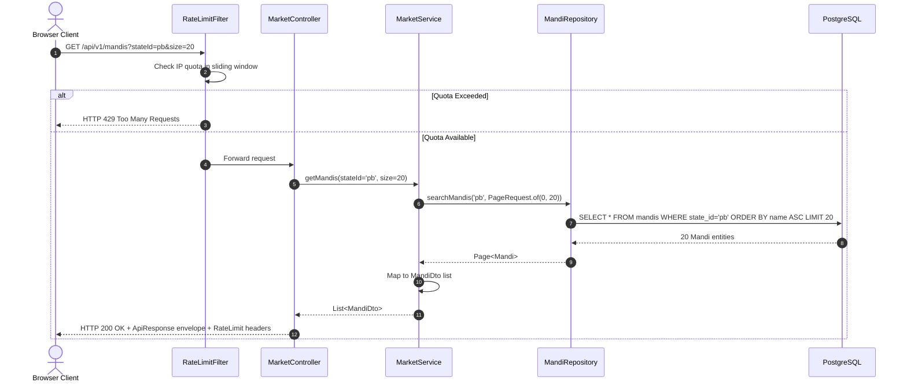

# Technical Implementation Details — Agri

## 1. Modular Monolith Architecture

The Java backend (`backend/src/main/java/com/agriforecasting`) is designed as a modular monolith:

### Key Design Patterns Used:
- **Repository Pattern:** Spring Data JPA repositories abstract database interactions.
- **Service Layer Pattern:** Encapsulates business logic, DTO transformations, and transaction boundaries (`@Transactional(readOnly = true)`).
- **Adapter Pattern:** `PythonModelClient` encapsulates HTTP communication with the Python FastAPI inference service.
- **Strategy Pattern:** `RateLimiter` interface implemented by `RedisSlidingWindowRateLimiter` (production) and `InMemorySlidingWindowRateLimiter` (development).
- **Controller Advice Pattern:** `GlobalExceptionHandler` converts exceptions to structured `ApiResponse<T>` objects.

---

## 2. Request Lifecycle: Browser to Database

---

## 3. Data Transformation & DTO Isolation

Entities (`Mandi`, `PriceObservation`, `ForecastRun`) never leak directly to API consumers.

Every service uses explicit DTO mapping:
- `toDto(mandi, userLat, userLon, commodityId)`
- `PriceObservationDto(id, mandiId, commodityId, varietyId, observationDate, modalPrice, minPrice, maxPrice, arrivals)`
- `ForecastPredictionDto(date, modalPrice, minPrice, maxPrice, percentageChangeFromReference)`

This guarantees backward compatibility if internal database column structures evolve.
