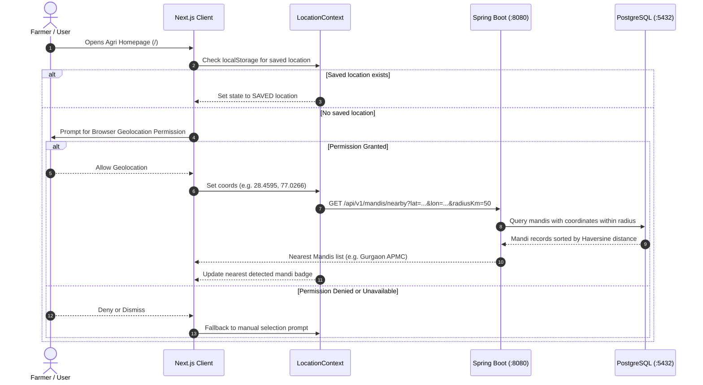
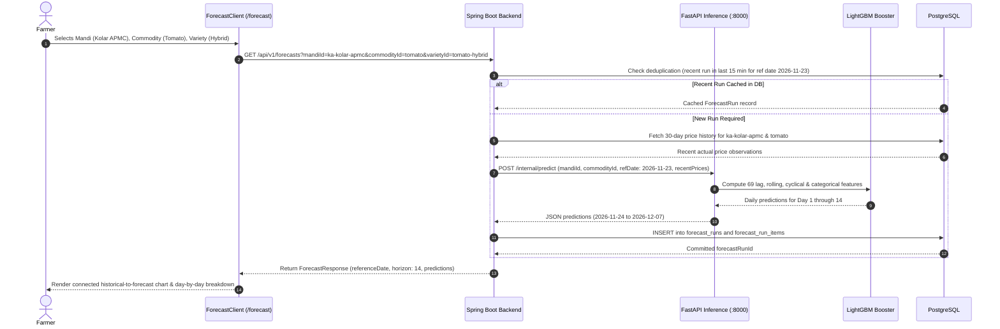

# User Flows & Interaction Specifications — Agri

## Overview

This document specifies the primary user journeys through Agri, mapping user interactions, system state transitions, API calls, and edge-case handling.

---

## Flow 1: Location Discovery & Immediate Market Highlight



---

## Flow 2: Dynamic Location Modal Cascade

```mermaid
sequenceDiagram
    autonumber
    actor User as User
    participant Modal as LocationSelectorModal
    participant Api as ApiService
    participant Backend as Spring Boot

    User->>Modal: Clicks "Change Location"
    Modal->>Api: getStates()
    Api->>Backend: GET /api/v1/states
    Backend-->>Modal: Return 30 States
    User->>Modal: Selects State (e.g. Punjab 'pb')
    Modal->>Api: getDistricts('pb')
    Api->>Backend: GET /api/v1/districts?stateId=pb
    Backend-->>Modal: Return 63 Districts in Punjab
    User->>Modal: Selects District (e.g. Ludhiana)
    Modal->>Api: getMandis({ districtId: 'pb-ludhiana' })
    Api->>Backend: GET /api/v1/mandis?districtId=pb-ludhiana
    Backend-->>Modal: Return Mandis in Ludhiana (Khanna APMC, etc.)
    User->>Modal: Selects Mandi and clicks "Apply Location"
    Modal->>LocationCtx: Update active location (label, stateId, districtId, mandiId)
    Modal-->>User: Closes modal; top header updates to "Punjab (Saved)"
```

---

## Flow 3: 14-Day Price Forecast Generation & Audit Archive



---

## Flow 4: Cross-Mandi Price Comparison

1. User navigates to `/compare`.
2. User selects a single commodity (e.g., `Tomato`) and variety (e.g., `Hybrid`).
3. User selects 2 to 5 mandis across any state (e.g., `Kolar APMC (Karnataka)` and `Amritsar APMC (Punjab)`).
4. System executes `GET /api/v1/comparisons?commodityId=tomato&varietyId=tomato-hybrid&mandiIds=ka-kolar-apmc,pb-amritsar-apmc`.
5. Backend verifies `mandiIds.size() <= 5` (returns HTTP 400 if exceeded).
6. Backend orchestrates current prices, historical observations, and 14-day forecasts for each market.
7. Frontend displays comparative price differential cards (identifying the highest and lowest markets) and multi-line Recharts visualization.

---

## Flow 5: Prediction History & Verification Audit

1. User opens `/prediction-history`.
2. Frontend queries `GET /api/v1/forecasts/history`.
3. Backend retrieves historical `forecast_runs` from PostgreSQL ordered by `generated_at DESC`.
4. User clicks "Inspect" on any run card.
5. Frontend requests `GET /api/v1/forecasts/history/{id}`.
6. Backend loads `forecast_run_items` and checks `price_observations` for any actual observations matching `target_date`.
7. Modal displays the original prediction alongside actual ground-truth market prices once recorded, calculating variance percentage.
